# AETHERA 🛰️☀️

**Linking machine-learning space weather forecasts to the risk of individual satellites, validated on real geomagnetic storms.**


AETHERA is an open, end-to-end **Sun-to-satellite** framework. It forecasts the geomagnetic Kp index with machine learning and turns that forecast into a **drag-risk score for each catalogued object** in low Earth orbit. An AI agent then writes **plain-language alerts** for non-experts. Everything runs on **freely available data** from NASA OMNI, Space-Track, CelesTrak, NOAA SWPC and NCEI.

This repository contains the code behind the research article:

> Habib, *"AETHERA: Linking Machine-Learning Space Weather Forecasts to the Risk of Individual Satellites"*, 2026.

---

## 📌 Why this project?

Geomagnetic storms heat and expand the upper atmosphere, which increases drag on low-orbit satellites. In **February 2022**, a minor storm (Kp ≈ 5) contributed to the loss of **38 of 49** newly launched Starlink satellites.

Today two kinds of tools exist, but they work separately:

| Tool | What it tells you | What it misses |
|---|---|---|
| Space weather forecasts (NOAA, ML models) | How disturbed the whole planet will be | **Which** satellites are at risk |
| TLE orbit catalogues (CelesTrak, Space-Track) | Where every object is | Space weather |

AETHERA joins them and explains the result in plain language.

---

## 🧭 How it works

```mermaid
flowchart LR
    A[1. Data<br/>OMNI · NOAA · TLEs] --> B[2. Kp forecast<br/>Random Forest / LSTM<br/>3–24 h ahead]
    B --> C[3. Per-satellite risk<br/>R = B* · exp&#40;-&#40;h-400&#41;/H&#41; · M&#40;Kp&#41;]
    C --> D[4. AI alert agent<br/>LangGraph + RAG<br/>monitor → assess → retrieve → write → check]
    D --> E[Plain-language alert<br/>for non-experts]
```



**Risk score for each satellite:**

$$
R = B^{*}\,\exp\!\left(-\frac{h_0 - 400\ \text{km}}{H}\right)\, M(\hat{K}_p), \qquad H = 60\ \text{km}
$$

where `B*` is the TLE drag term, `h₀` is the mean altitude and `M` is a storm-time density multiplier (1, 1.5, 3, 6 and 10 for Kp ≤ 3, ≤ 5, ≤ 7, ≤ 8 and > 8).

---

## ❓ Research questions

| | Question |
|---|---|
| **RQ1** | How accurately can ML (LSTM, Random Forest) forecast Kp 3–24 hours ahead, compared with persistence and with NOAA SWPC's own operational forecast? |
| **RQ2** | Does the per-satellite risk score identify the objects that lost the most altitude in real storms, across a range of storms from 2003 to 2025? |
| **RQ3** | Are alerts from a RAG-based agent more accurate and readable than those of a plain language model? |

---

## 📊 Key results (original 3-storm / 40-scenario study)

### RQ1: Kp forecasting (test set 2022–2024)

| RMSE | 3 h | 6 h | 12 h | 24 h |
|---|---|---|---|---|
| Persistence | 0.900 | 1.164 | 1.386 | 1.606 |
| **Random Forest** | **0.807** | **0.997** | **1.151** | **1.265** |
| LSTM | 0.806 | 1.012 | 1.205 | 1.339 |

- Random Forest is **10–21% better** than persistence. The independent **2025** year confirms this.
- The LSTM gives no clear advantage over the Random Forest.
- **No model detects storms reliably 24 h ahead** (TSS < 0.1).

### RQ2: Per-satellite risk (passive objects, Spearman ρ)

| Score | 2003 Halloween | 2022 Starlink | 2024 Gannon |
|---|---|---|---|
| Altitude only | 0.52 | 0.54 | 0.45 |
| **Physics score R** | **0.92** | **0.95** | **0.93** |
| ML score (leave-one-storm-out) | 0.97 | 0.96 | 0.97 |
| Pre-storm decay rate | 0.98 | 0.97 | 0.97 |

- A score built from a **single TLE** ranks objects far better than altitude alone.
- **B\*** carries most of the information.

> The journal-revision extension (scripts `11`–`16c`) re-runs RQ1 against NOAA's own forecast,
> adds NRLMSIS 2.0 atmospheric density, extends RQ2 to 8 storms (2003–2025), and repeats RQ3 across
> 3 LLM families at 100 scenarios — see `results/step4`–`results/step6c` for those updated numbers
> and their `summary.txt` files for the full discussion (including baseline-contamination and
> forecast-availability caveats found during that extension).

### RQ3: AI-generated alerts (40 situations, gpt-oss-120b)

| Measure | Plain LLM | RAG | **AETHERA agent** |
|---|---|---|---|
| Alerts with any error | 45.0% | 2.5% | **0%** |
| Severity overstated | 40.0% | 0% | 0% |
| Flesch reading ease | 46.8 | 60.9 | **61.8** |

The difference between the plain LLM and the agent is significant (exact McNemar test, p < 0.0001).

### 🔴 Live prototype

The full chain ran **autonomously on live NOAA and CelesTrak data** on 12 October 2026.

---

## 📁 Repository structure

```
AETHERA/
├── README.md
├── LICENSE
├── CITATION.cff
├── requirements.txt
├── .env.example               # template for API keys (never commit .env)
├── config.py                  # shared paths, date ranges, storm windows
├── code/                      # all pipeline scripts, numbered in run order - see below
├── data/
│   ├── raw/                   # downloaded OMNI, TLE, NOAA files (not committed - see .gitignore)
│   └── clean/                 # cleaned/derived datasets used by the pipeline
├── results/                   # metrics, figures and summaries produced by each script
│   ├── step2/ … step6c/       # outputs of the journal-revision extension scripts (11-16c)
│   └── live/                  # output of the live prototype (10_live_agent.py)
├── notes/, paper/              # manuscript working files
```

---

## ⚙️ Installation

```bash
git clone https://github.com/habib-u-rahman/AETHERA.git
cd AETHERA
python -m venv .venv
.venv\Scripts\activate          # Windows; use `source .venv/bin/activate` on Linux/Mac
pip install -r requirements.txt
```

### 🔑 API keys and accounts

Copy `.env.example` to `.env` and fill in your own values:

```env
GROQ_API_KEY=       # free key at https://console.groq.com/keys - needed for scripts 08, 10, 11
ST_USER=            # Space-Track.org login - needed for scripts 03, 15
ST_PASS=
```

> ⚠️ **Never commit your `.env` file.** It is already listed in `.gitignore`.

---

## ▶️ Usage

Scripts are numbered in the order they must run (each depends on the previous steps' output).
`01`–`10` are the original RQ1/RQ2/RQ3 pipeline; `11`–`16c` are the journal-revision extensions.

| # | Script | What it does | Produces |
|---|---|---|---|
| 01 | `code/01_download_omni.py` | downloads raw OMNI hourly solar-wind/Kp/Dst/F10.7 data (2000–2025) | `data/raw/omni/omni2_*.dat` |
| 02 | `code/02_clean_omni.py` | cleans/merges into one hourly table, builds train/test splits | `data/clean/omni_hourly.csv`, `train.csv`, `test.csv`, `test_2003.csv`, `data_report.txt` |
| 03 | `code/03_download_tles.py` | downloads historical TLEs (Space-Track) for the 3 original storms | `data/raw/tle/<storm>.csv` |
| 04 | `code/04_clean_tles.py` | cleans TLEs, derives altitude, flags maneuvers | `data/clean/tle_<storm>.csv`, `decay_<storm>.csv` |
| 05 | `code/05_check_data.py` | sanity-check plots | `results/fig_kp_2000_2024.png`, `fig_storm_<storm>.png` |
| 06 | `code/06_rq1_forecast.py` | **RQ1**: trains Persistence/RF/LSTM, tunes alarm thresholds | `results/rq1_metrics.csv`, `rq1_forecasts.csv`, `rq1_summary.txt`, `lstm_kp.keras`, `fig_rq1_rmse.png`, `fig_rq1_<storm>.png` |
| 07 | `code/07_rq2_risk.py` | **RQ2**: per-object ground truth + 5 risk scores (leave-one-storm-out ML) | `results/rq2_objects.csv`, `rq2_summary.txt`, `fig_rq2_scatter.png`, `fig_rq2_skill.png` |
| 08 | `code/08_rq3_alerts.py` | **RQ3**: 40 scenarios × 3 systems (Plain LLM / RAG / AETHERA agent) via Groq, auto-checked | `results/rq3_scenarios.json`, `rq3_alerts.csv`, `rq3_summary.txt`, `rq3_cache_<model>.json`, `fig_rq3.png` |
| 09 | `code/09_test_2025.py` | RQ1 extra 2025 holdout (loads the saved LSTM, no retraining) | `results/rq1_2025_metrics.csv`, `rq1_2025_forecasts.csv`, `rq1_2025_summary.txt`, `fig_rq1_2025_rmse.png`, `fig_rq1_2025_storm.png` |
| 10 | `code/10_live_agent.py` | live prototype: fetch → forecast → risk-rank → write/check an alert | `results/rf_kp.joblib` (built once), `results/live/alert_*.md`, `facts_*.json`, `fig_live_*.png` |
| 11 | `code/11_rq3_extended.py` | RQ3 at scale: 100 scenarios × 3 systems × 3 models (gpt-oss-120b, Qwen3.8-27B, Allam-2-7B) | `results/step2/rq3x_scenarios.json`, `rq3x_cache_<model>.json`, `rq3x_alerts.jsonl`, `rq3x_summary.txt` |
| 12 | `code/12_lstm_seeds.py` | RQ1 LSTM seed-stability (5 seeds, RF/Persistence shared) | `results/step2/lstm_seeds_metrics.csv`, `lstm_seeds_forecasts.csv` |
| 13 | `code/13_noaa_comparison.py` | RQ1 vs NOAA SWPC's official 3-day Kp forecast archive (2022–2025) | `results/step4/noaa_comparison.csv`, `noaa_comparison_bootstrap.csv`, `fig_noaa_comparison.png`, `summary.txt` |
| 14 | `code/14_probabilistic.py` | turns the RQ1 RF into a probabilistic forecaster (split-conformal + isotonic) | `results/step5/prob_metrics.csv`, `reliability_bins.csv`, `fig_prob_reliability.png`, `fig_prob_gannon.png`, `summary.txt` |
| 14b | `code/14b_storm_coverage.py` | interval coverage conditioned on actual storm hours (Kp≥5, Kp≥7) | `results/step5/storm_coverage.csv` |
| 15 | `code/15_more_storms.py` | downloads/cleans 5 additional storms (2015, 2017, 2023, 2024-Oct, 2025-Nov) | `data/raw/tle/<new storm>.csv`, `data/clean/tle_<new storm>.csv`, `decay_<new storm>.csv` |
| 16 | `code/16_rq2_extended.py` | RQ2 across all 8 storms + NRLMSIS 2.0 density score (`pymsis`), bootstrap CIs | `results/step6/rq2x_objects.csv`, `rq2x_summary.csv`, `fig_rq2x_skill.png`, `summary.txt` |
| 16b | `code/16b_rq2_baseline_check.py` | baseline-contamination audit + a forecast-Kp data-leakage fix | `results/step6b/rq2x_baseline_check.csv`, `baseline_windows.csv`, `storm_diagnostics.csv`, `summary.txt` |
| 16c | `code/16c_rq2_final.py` | final RQ2 scores made cleanly independent of the Kp forecast; clean leave-one-storm-out ML | `results/step6c/rq2x_final_scores.csv`, `rq2x_final_summary.csv`, `rq2x_final_within_storm.csv`, `rq2x_final_alt_baseline.csv`, `rq2x_final_pooled_kp.csv`, `fig_rq2x_final_skill.png`, `summary.txt` |

Scripts 03, 08, 10, 11 and 15 call external APIs (Space-Track, Groq) and are rate-limited /
resumable by design — they may need to be re-run across multiple sessions to finish; cached
progress is never lost.

---

## 🌐 Data sources (all free)

| Data | Source | Use |
|---|---|---|
| Hourly solar wind and Kp, Dst, F10.7 (2000–2025) | [NASA OMNI](https://omniweb.gsfc.nasa.gov/) | Train and test the Kp forecast |
| Historical TLEs | [Space-Track](https://www.space-track.org/) (free account) | Storm-time orbital decay |
| Current TLEs | [CelesTrak](https://celestrak.org/) | Live prototype |
| Real-time solar wind and Kp | [NOAA SWPC](https://www.swpc.noaa.gov/) | Live prototype |
| Archived 3-day Kp forecast products | [NOAA NCEI](https://www.ngdc.noaa.gov/stp/space-weather/swpc-products/daily_reports/3day_forecast/) | Human-forecaster baseline for RQ1 (script 13) |
| Kp definition | [GFZ Potsdam](https://kp.gfz-potsdam.de/) | Reference index |

> Please respect the usage rules: **CelesTrak** allows one download of the same data every 2 hours, and **Space-Track** has query rate limits.

---

## ⚠️ Limitations

- The forecast uses only solar wind measured at L1, so it **cannot see a storm a day ahead**.
- The original RQ2 validation used only **three storms**; the extended validation (scripts
  `15`–`16c`) adds five more but found that storms with an already-disturbed pre-storm baseline
  (Kp≥6 in the 6 days before onset) measurably degrade every risk score's accuracy — see
  `results/step6b/summary.txt` and `results/step6c/summary.txt`.
- Ranking of **active satellites** is weak because they manoeuvre.
- Alerts were tested across 3 LLM families (`results/step2`), but still only in English, without a
  human reader study.

## 🔭 Future work

- Add solar inputs (flares, CMEs) to extend the forecast lead time.
- ~~Produce probabilistic forecasts~~ — done, see `code/14_probabilistic.py`.
- ~~Use a physical density model instead of the step multiplier~~ — done, see `code/16_rq2_extended.py` (NRLMSIS 2.0).
- Generate alerts in **Urdu** and other languages.
- Run the live prototype through a real storm season.

---

## 📄 Citation

If you use this work, please cite — see [`CITATION.cff`](CITATION.cff), or:

```bibtex
@misc{habib2026aethera,
  author = {Habib},
  title  = {{AETHERA}: Linking Machine-Learning Space Weather Forecasts to the Risk of Individual Satellites},
  year   = {2026},
  howpublished = {\url{https://github.com/habib-u-rahman/AETHERA}},
  doi    = {10.5281/zenodo.23816103}
}
```

Archived release: [10.5281/zenodo.23816103](https://doi.org/10.5281/zenodo.23816103)

---

## 📜 License

This project is released under the [MIT License](LICENSE).

## 🙏 Acknowledgements

Thanks to NASA/GSFC SPDF for OMNI data, GFZ Potsdam for the Kp index, NOAA SWPC and NCEI for
forecast products, CelesTrak and Space-Track for orbital data, and Groq for language-model access.

## 📬 Contact

**Habib** — see the repository for contact details.
