# AETHERA 🛰️☀️

**Linking machine-learning space weather forecasts to the risk of individual satellites, validated on real geomagnetic storms.**


AETHERA is an open, end-to-end **Sun-to-satellite** framework. It forecasts the geomagnetic Kp index with machine learning and turns that forecast into a **drag-risk score for each catalogued object** in low Earth orbit. An AI agent then writes **plain-language alerts** for non-experts. Everything runs on **freely available data** from NASA OMNI, Space-Track, CelesTrak and NOAA SWPC.

This repository contains the code, figures and paper for the research article:

> Habib, *"AETHERA: Linking Machine-Learning Space Weather Forecasts to the Risk of Individual Satellites, Validated on Real Geomagnetic Storms"*, 2026.

---

## 📌 Why this project?

Geomagnetic storms heat and expand the upper atmosphere, which increases drag on low-orbit satellites. In **February 2022**, a minor storm (Kp ≈ 5) contributed to the loss of **38 of 49** newly launched Starlink satellites.

Today two kinds of tools exist, but they work separately:

| Tool | What it tells you | What it misses |
|---|---|---|
| Space weather forecasts (NOAA, ML models) | How disturbed the whole planet will be | **Which** satellites are at risk |
| TLE orbit catalogues (CelesTrak, Space-Track) | Where every object is | Space weather |

AETHERA joins them and explains the result in plain language.

---

## 🧭 How it works

```mermaid
flowchart LR
    A[1. Data<br/>OMNI · NOAA · TLEs] --> B[2. Kp forecast<br/>Random Forest / LSTM<br/>3–24 h ahead]
    B --> C[3. Per-satellite risk<br/>R = B* · exp&#40;-&#40;h-400&#41;/H&#41; · M&#40;Kp&#41;]
    C --> D[4. AI alert agent<br/>LangGraph + RAG<br/>monitor → assess → retrieve → write → check]
    D --> E[Plain-language alert<br/>for non-experts]
```



**Risk score for each satellite:**

$$
R = B^{*}\,\exp\!\left(-\frac{h_0 - 400\ \text{km}}{H}\right)\, M(\hat{K}_p), \qquad H = 60\ \text{km}
$$

where `B*` is the TLE drag term, `h₀` is the mean altitude and `M` is a storm-time density multiplier (1, 1.5, 3, 6 and 10 for Kp ≤ 3, ≤ 5, ≤ 7, ≤ 8 and > 8).

---

## ❓ Research questions

| | Question |
|---|---|
| **RQ1** | How accurately can ML (LSTM, Random Forest) forecast Kp 3–24 hours ahead, compared with persistence? |
| **RQ2** | Does the per-satellite risk score identify the objects that lost the most altitude in real storms? |
| **RQ3** | Are alerts from a RAG-based agent more accurate and readable than those of a plain language model? |

---

## 📊 Key results

### RQ1: Kp forecasting (test set 2022–2024)

| RMSE | 3 h | 6 h | 12 h | 24 h |
|---|---|---|---|---|
| Persistence | 0.900 | 1.164 | 1.386 | 1.606 |
| **Random Forest** | **0.807** | **0.997** | **1.151** | **1.265** |
| LSTM | 0.806 | 1.012 | 1.205 | 1.339 |

- Random Forest is **10–21% better** than persistence. The independent **2025** year confirms this.
- The LSTM gives no clear advantage over the Random Forest.
- **No model detects storms reliably 24 h ahead** (TSS < 0.1).

### RQ2: Per-satellite risk (passive objects, Spearman ρ)

| Score | 2003 Halloween | 2022 Starlink | 2024 Gannon |
|---|---|---|---|
| Altitude only | 0.52 | 0.54 | 0.45 |
| **Physics score R** | **0.92** | **0.95** | **0.93** |
| ML score (leave-one-storm-out) | 0.97 | 0.96 | 0.97 |
| Pre-storm decay rate | 0.98 | 0.97 | 0.97 |

- A score built from a **single TLE** ranks objects far better than altitude alone.
- **B\*** carries most of the information.

### RQ3: AI-generated alerts (40 situations, gpt-oss-120b)

| Measure | Plain LLM | RAG | **AETHERA agent** |
|---|---|---|---|
| Alerts with any error | 45.0% | 2.5% | **0%** |
| Severity overstated | 40.0% | 0% | 0% |
| Flesch reading ease | 46.8 | 60.9 | **61.8** |

The difference between the plain LLM and the agent is significant (exact McNemar test, p < 0.0001).

### 🔴 Live prototype

The full chain ran **autonomously on live NOAA and CelesTrak data** on 12 October 2026.

---

## 📁 Repository structure

> ✏️ Adjust the file names below to match your own scripts.

```
aethera/
├── README.md
├── LICENSE
├── requirements.txt
├── .env.example              # template for API keys (never commit .env)
├── data/
│   ├── raw/                  # downloaded OMNI, TLE, NOAA files (not committed)
│   └── processed/            # cleaned datasets
├── src/
│   ├── 01_download_omni.py
│   ├── 02_clean_omni.py
│   ├── 03_train_forecast.py      # Persistence, Random Forest, LSTM (RQ1)
│   ├── 04_evaluate_forecast.py
│   ├── 05_download_tles.py
│   ├── 06_storm_decay.py         # ground truth: excess altitude loss
│   ├── 07_risk_score.py          # physics + ML risk scores (RQ2)
│   ├── 08_alert_agent.py         # plain LLM vs RAG vs LangGraph agent (RQ3)
│   ├── 09_evaluate_alerts.py
│   └── 10_live_agent.py          # live prototype
├── knowledge_base/           # NOAA scale statements used by RAG
├── results/
│   ├── figures/
│   └── tables/
└── paper/
    ├── main.tex
    ├── references.bib
    └── AETHERA_Paper.pdf
```

---

## ⚙️ Installation

```bash
git clone https://github.com/<your-username>/aethera-sun-to-satellite.git
cd aethera-sun-to-satellite
python -m venv venv
source venv/bin/activate          # Windows: venv\Scripts\activate
pip install -r requirements.txt
```

**Main libraries:** `numpy`, `pandas`, `scikit-learn`, `tensorflow` (or `keras`), `sgp4`, `scipy`, `matplotlib`, `langgraph`, `groq`, `requests`, `textstat`.

### 🔑 API keys and accounts

Copy `.env.example` to `.env` and fill in your own values:

```env
GROQ_API_KEY=your_key_here
SPACETRACK_USER=your_email
SPACETRACK_PASSWORD=your_password
```

> ⚠️ **Never commit your `.env` file.** It is already listed in `.gitignore`.

---

## ▶️ Usage

Run the scripts in order to reproduce the paper:

```bash
# RQ1 – Kp forecasting
python src/01_download_omni.py
python src/02_clean_omni.py
python src/03_train_forecast.py
python src/04_evaluate_forecast.py

# RQ2 – per-satellite risk
python src/05_download_tles.py
python src/06_storm_decay.py
python src/07_risk_score.py

# RQ3 – AI alerts
python src/08_alert_agent.py
python src/09_evaluate_alerts.py

# Live prototype
python src/10_live_agent.py
```

Figures and tables are saved in `results/`.

---

## 🌐 Data sources (all free)

| Data | Source | Use |
|---|---|---|
| Hourly solar wind and Kp, Dst, F10.7 (2000–2025) | [NASA OMNI](https://omniweb.gsfc.nasa.gov/) | Train and test the Kp forecast |
| Historical TLEs | [Space-Track](https://www.space-track.org/) (free account) | Storm-time orbital decay |
| Current TLEs | [CelesTrak](https://celestrak.org/) | Live prototype |
| Real-time solar wind and Kp | [NOAA SWPC](https://www.swpc.noaa.gov/) | Live prototype |
| Kp definition | [GFZ Potsdam](https://kp.gfz-potsdam.de/) | Reference index |

> Please respect the usage rules: **CelesTrak** allows one download of the same data every 2 hours, and **Space-Track** has query rate limits.

---

## ⚠️ Limitations

- The forecast uses only solar wind measured at L1, so it **cannot see a storm a day ahead**.
- Only **three storms** were used to validate the risk score, and the ground truth comes from noisy TLEs.
- Ranking of **active satellites** is weak because they manoeuvre.
- Alerts were tested with **one language model**, in English only, without a human reader study.

## 🔭 Future work

- Add solar inputs (flares, CMEs) to extend the forecast lead time.
- Produce probabilistic forecasts.
- Use a physical density model instead of the step multiplier.
- Generate alerts in **Urdu** and other languages.
- Run the live prototype through a real storm season.

---

## 📄 Citation

If you use this work, please cite:

```bibtex
@misc{habib2026aethera,
  author = {Habib},
  title  = {{AETHERA}: Linking Machine-Learning Space Weather Forecasts to the Risk of Individual Satellites, Validated on Real Geomagnetic Storms},
  year   = {2026},
  howpublished = {\url{https://github.com/<your-username>/aethera-sun-to-satellite}}
}
```

---

## 📜 License

This project is released under the [MIT License](LICENSE).

## 🙏 Acknowledgements

Thanks to NASA/GSFC SPDF for OMNI data, GFZ Potsdam for the Kp index, NOAA SWPC for real-time products, CelesTrak and Space-Track for orbital data, and Groq for language-model access.

## 📬 Contact

**Habib**, Department of ______, University of ______, Pakistan
✉️ your-email@example.com
